# Project gallery

[Back to my profile](README.md)

A visual inventory of my product, engineering, and creative work. Reviewed November 17, 2026. Screenshots show actual pages or existing outputs; captions distinguish live websites, local prototypes, synthetic inputs, and preproduction. A screenshot is not proof of commercial release or every backend feature.

[Public products](#public-products) · [Web and browser tools](#web-and-browser-tools) · [Analytics and research](#analytics-and-research) · [Animation and design](#animation-and-design) · [Additional work and publication limits](#additional-work-and-publication-limits)

## Public products

### FlowJob

**Founder & solo developer · Public website**

Futures education and a Trading Journal for planning, recording, and reviewing decisions. My work spans the public site, learning workspace, accounts, journal, checkout, and operating tools. Next.js, React, TypeScript, and PostgreSQL/Supabase.

[Case study](https://github.com/iqbalnett/flowjob-showcase) · [Public website](https://www.flowjob.id/)

*Public-page capture from November 7, 2026; public homepage revisited November 17. No customer journal or private learning material is shown.*

### FlowStore

**Founder & solo developer · Public website**

Digital-service discovery, membership comparison, checkout, and returning-customer workspaces. Next.js, React, TypeScript, and PostgreSQL/Supabase. The public case study discusses interface and workflow decisions without releasing operational source.

[Case study](https://github.com/iqbalnett/flowstore-showcase) · [Public website](https://flowstore.digital/)

*Public-page capture from November 7, 2026; homepage revisited November 17. Offers can change. This is not an authenticated customer workspace.*

### FlowStream

**Sports-schedule frontend · Public website**

Search and browse matches, filter by sport and time, and switch between Indonesian and English. Built with HTML, CSS, and JavaScript. Schedule and stream availability depend on third-party providers.

[Public website](https://flowstreamid.vercel.app/)

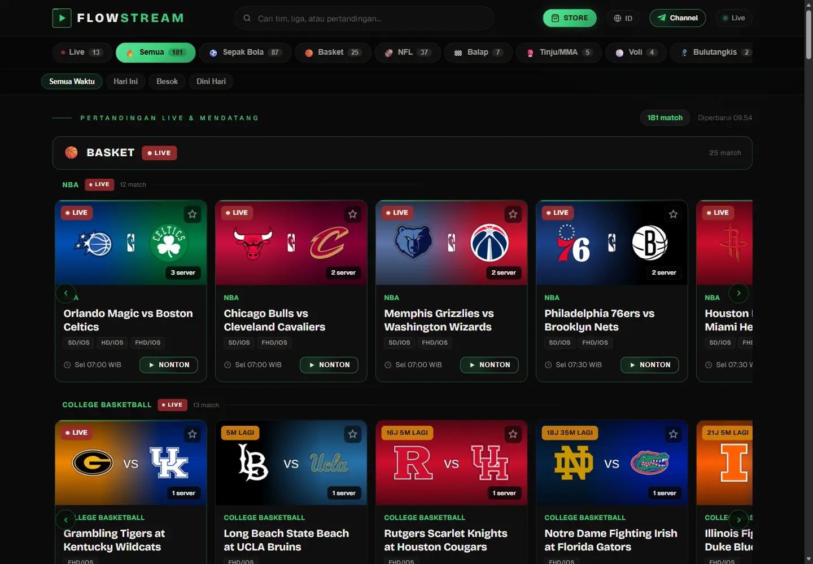

*Public schedule captured November 17, 2026. No stream playback, account data, or chat is included. Provider listings and broadcast permissions are not independently verified by this portfolio.*

## Web and browser tools

### Brew Theory

**Coffee recipe calculator · Local frontend**

A React and TypeScript coffee guide with Espresso/Americano modes and adjustable dose, ratio, water, and temperature. The captured calculator was exercised: changing the dose updated yield and water amounts, then the input was restored.

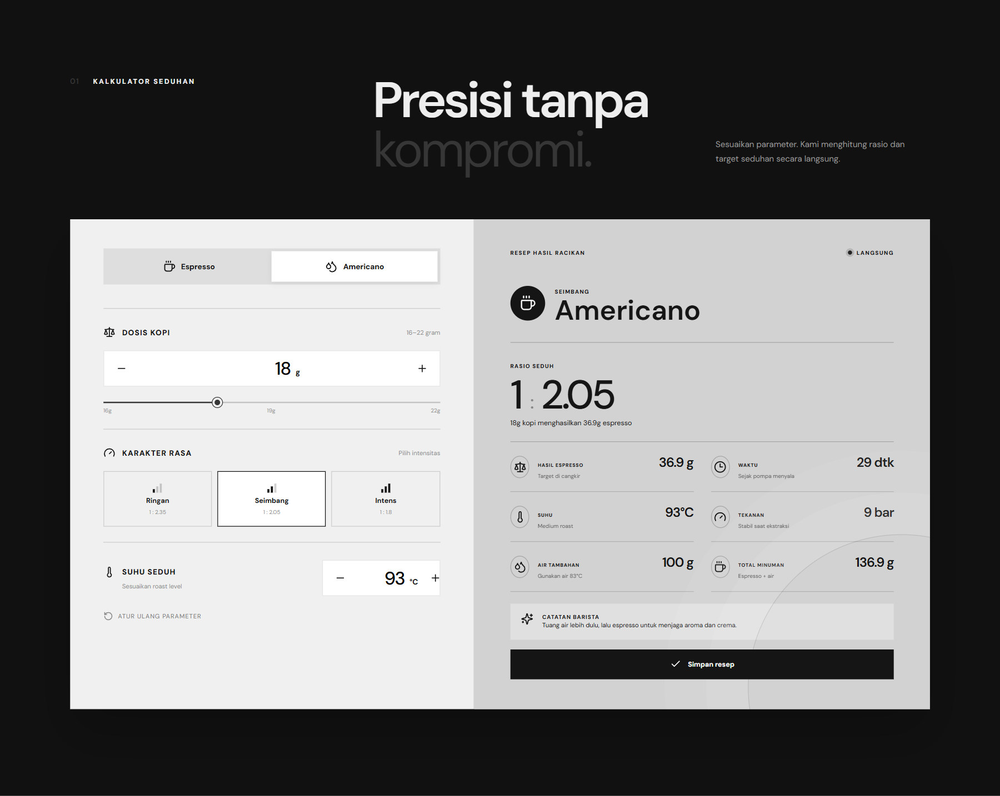

*Real local-preview calculator, not a cafe deployment or a scientific validation claim. Vite, React, TypeScript, CSS.*

### Toba Journeys

**Travel discovery and itinerary planning · Local prototype**

Bilingual North Sumatra travel pages with destination discovery, filters, and itinerary-inquiry flows. The site does not establish a booking or payment service. Built with HTML, CSS, JavaScript, and Vite.

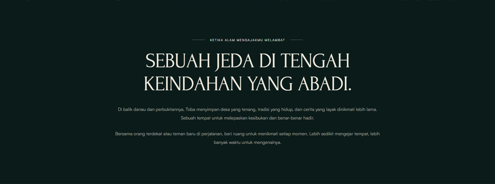

*Actual local page section. This text-only crop deliberately excludes destination photographs whose source-to-file attribution remains unresolved. Displayed trip prices elsewhere are not treated as verified offers.*

### Shopee Market Lens

**Manual product-research extension · Local browser tool**

A Manifest V3 extension for user-triggered public-listing snapshots, cohort comparisons, data-quality review, and configurable research thresholds. JavaScript, HTML, CSS, and Chrome extension storage.

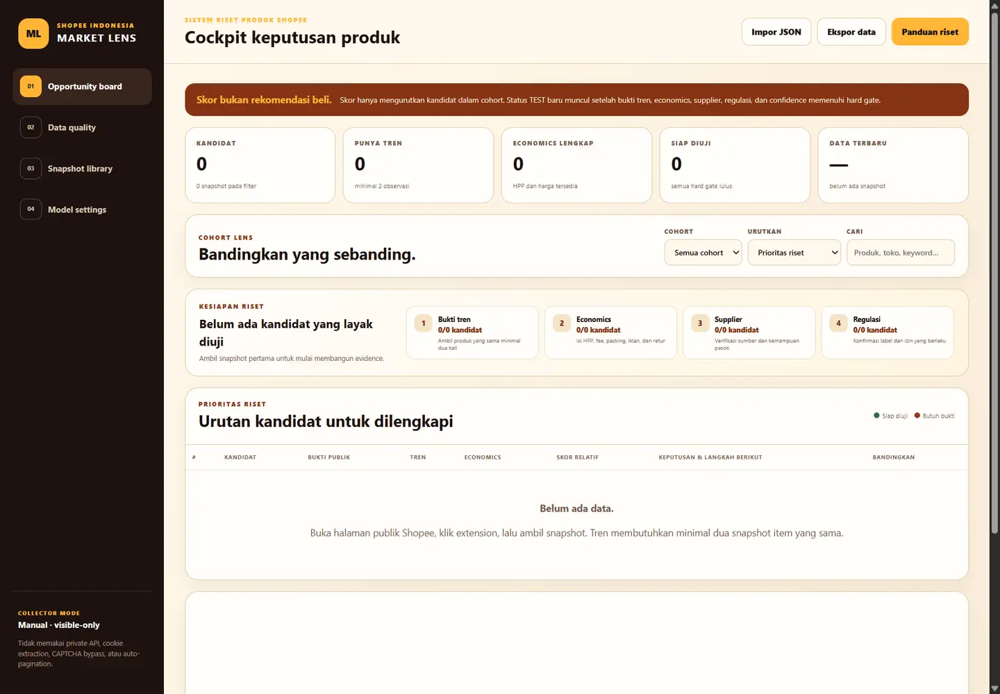

*Actual extension dashboard loaded in a clean, separate browser profile. Empty storage is intentional; no real store research, account session, API token, or fabricated product ranking was imported. The Data quality view was also opened. Scores are research aids, not purchase recommendations. A related Python crawler experiment is not presented as a separate verified product.*

### CYBER DEMON

**Educational tools catalogue · Local web application**

A searchable catalogue of security and development resources, with other service interfaces behind separate configuration requirements. React, TypeScript, React Router, Tailwind CSS, and Vite.

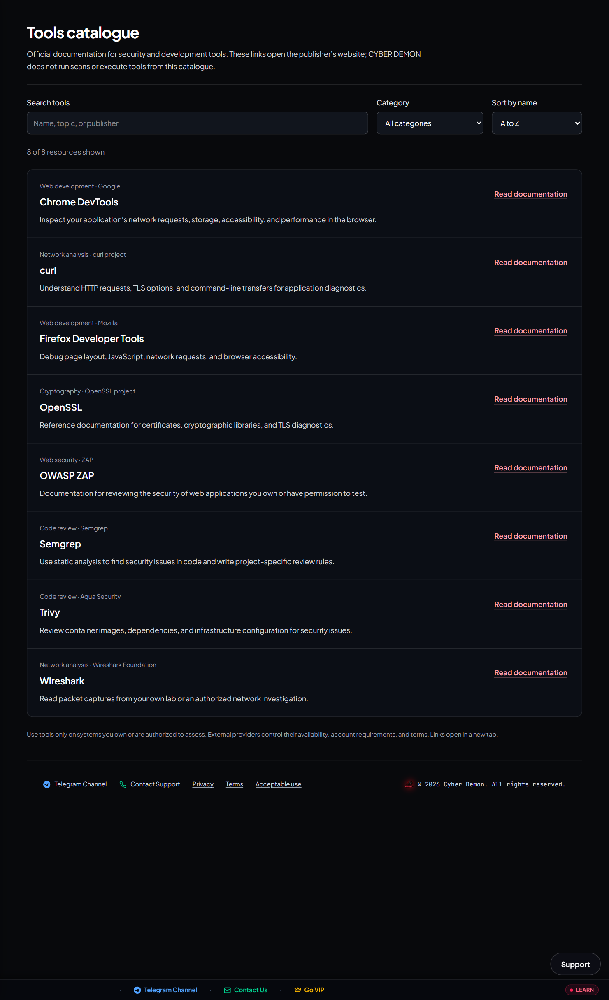

*Existing-build content crop. No scans, account collections, private datasets, mailboxes, or configured backend operations are demonstrated. The broader interface adapts a public design reference; this is not a claim that every visual element is original.*

### Community-health visit form

**Multi-step household-visit form · Local prototype**

HTML, CSS, and JavaScript form workflow with dynamic rows, local draft handling, print preparation, and local photo previews. The capture shows the actual second step reached through the Next button.

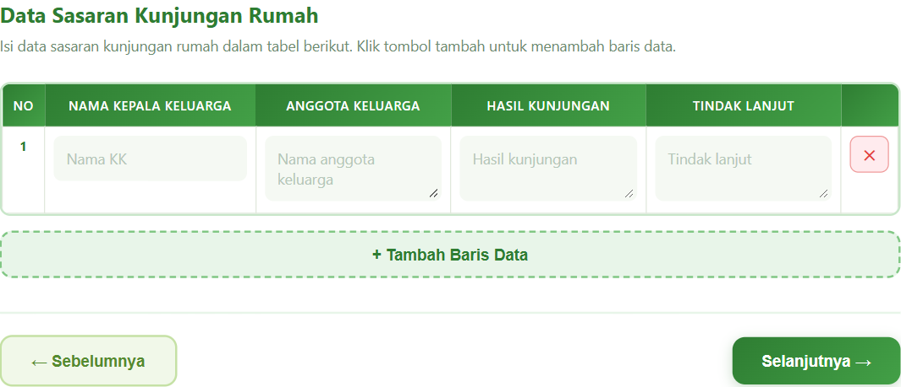

*Anonymized UI sample published with the owner's permission. Institution branding, client identity, household data, signatures, and photographs are excluded. No institutional deployment or medical-record backend is claimed.*

### TokoDigital

**Digital-goods storefront · Archived local prototype**

A Next.js and React storefront experiment with product categories, product pages, and WhatsApp-order entry points. The existing build was opened locally; no order was submitted.

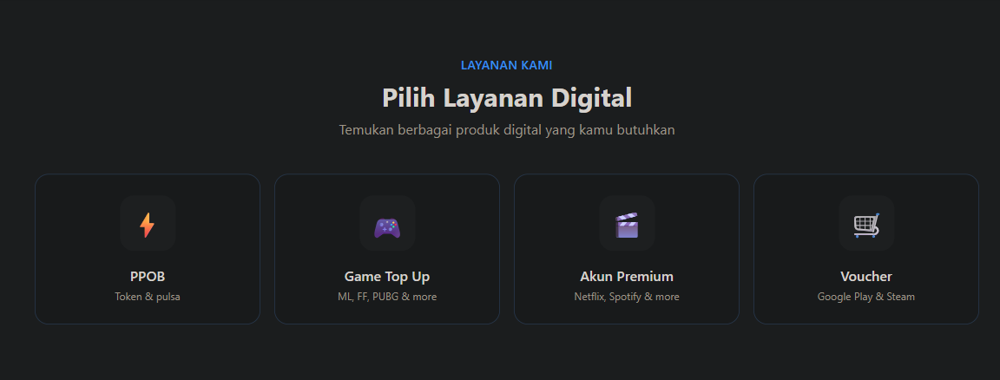

*Category-section crop only. The prototype contains placeholder contact configuration; availability, fulfillment, pricing, and marketing assurances are not verified. It is not presented as another operating store.*

## Analytics and research

### FlowGex

**Options analytics and market visualization · Private research application**

Python-based analytics, historical replay, and browser visualization. This sample uses the project's existing deterministic contract-fixture environment rather than licensed market recordings or personal trading journals.

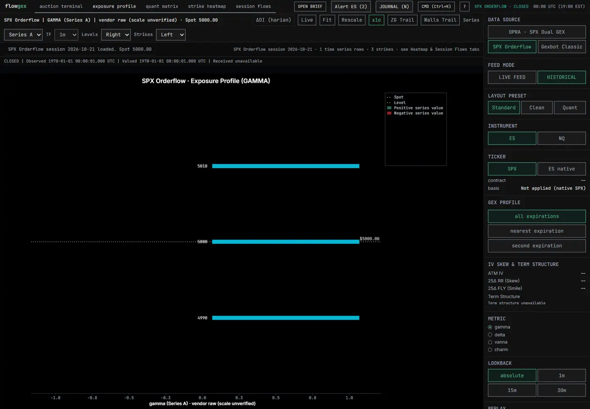

**Synthetic-data demonstration.** Values, dates, and connection indicators belong to the test fixture; they are not evidence of a live feed, dealer inventory, trading performance, or a recommendation. The native-live worktree is part of this project, not an additional product.

### TradingStats Independent Trading Engine

**Futures-indicator research · Local Python project**

Research around retracements, standard-deviation levels, initial balance, gap behavior, session probabilities, and volume profiles. Python/FastAPI with a browser dashboard.

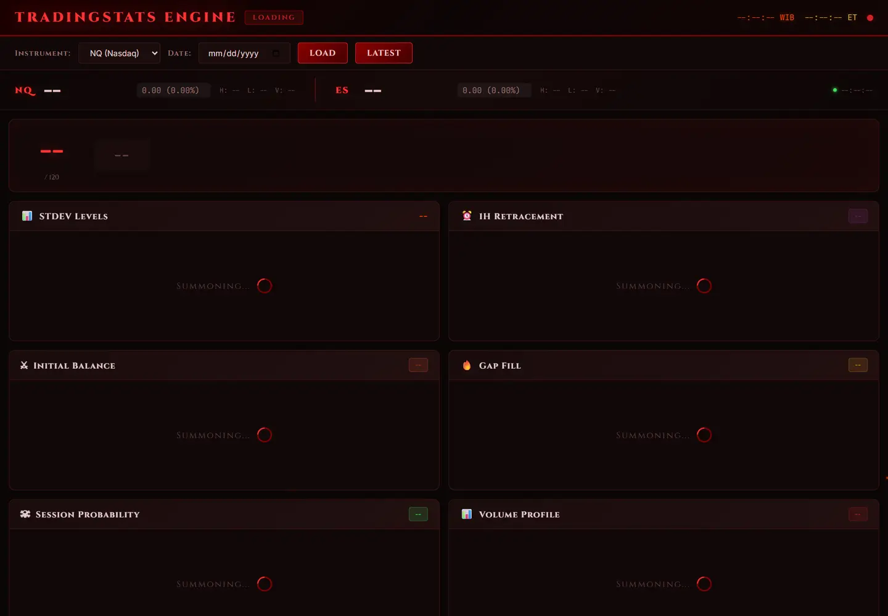

*Actual disconnected dashboard presentation. No market records were loaded and no analytical accuracy or live operation is claimed. Delivery-folder copies are not counted separately.*

### FlowGreeks

**Options ingestion, calculation, and replay · Private research family**

Python and Go implementations explore deterministic ingestion, options analytics, and replay; an earlier Next.js frontend also exists. They are grouped as one research family, not several public launches.

**Visual withheld:** the Go frontend remained at its waiting-for-state screen, and the earlier landing preview did not render reliably enough for a portfolio image. The Python dashboard was not executed because its startup file requires a separate security review. No licensed feed data or synthetic success screenshot is substituted. Production/live validation remains limited.

### Flow Macro

**Macro-context dashboard · Private FlowJob-family tool**

A Next.js interface for macro context, news, and calendar views. Not a separate verified public product.

**Visual withheld:** the available prototype includes snapshot/market content without cleared publication provenance. Its private deployment address and underlying data remain unpublished.

### Zora Conviction Engine

**Content planning and review · Private team tool**

Composer, topic research, launch-readiness, and post-review workflows using Next.js, TypeScript, and Supabase. Planning support does not guarantee trading outcomes.

**Visual withheld:** the inspected local build stopped at an unconfigured login screen. Private team records and backend details are not exposed to obtain a more impressive screenshot.

## Animation and design

### Dilema Dika

**Indonesian 2D animation · Preproduction**

Character design, scene blocking, storyboards, and motion studies for a slice-of-life series. Custom episode work uses React, TypeScript, SVG scenes, and Remotion.

*Existing Kirim Uang storyboard render, not a released episode. Dialogue, voice permissions, and final production review remain incomplete. The production setup adapts the [FreshStack What If animation toolkit](https://github.com/kelano86/what-if-animation); inherited example episodes are not claimed as my original work.*

### FlowRouter

**Local batch-video workstation · Existing generated output**

Node.js and browser-JavaScript tooling for job queues, worker routing, status, and reviewing saved generation outputs.

*Still at 0.5 seconds from an existing generated clip. This is output evidence, not a dashboard screenshot or a real filmed location. Account-connected dashboard views, browser profiles, and signed URLs remain private. Generated material remains subject to the provider's terms.*

### Educational video pipeline

**Financial explainer production · Local production workflow**

Scripted assembly of generated scenes, narration, subtitles, and explanatory graphics with Python and FFmpeg. Related educational animation studies use Remotion and Manim; these are stages of the same media work, not separate SaaS products.

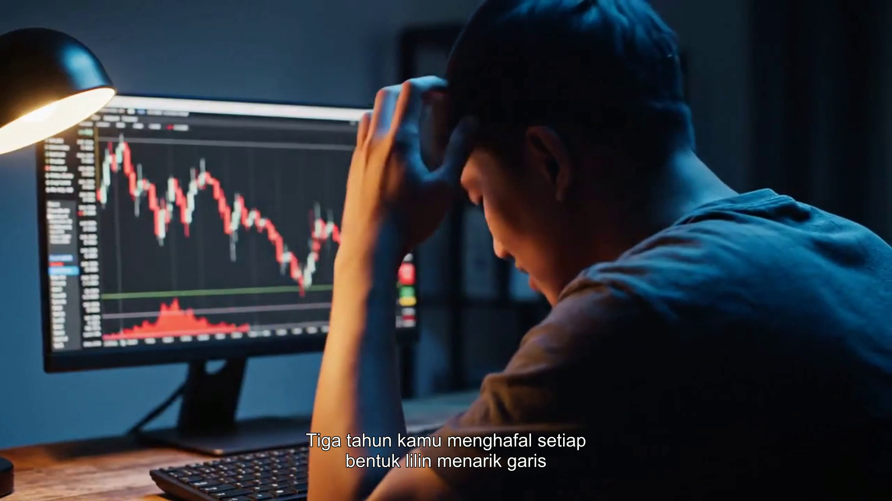

*Still at 12 seconds from an existing earlier video assembly. The person and chart imagery are generated illustration, not a real customer, live market data, or trading result. No audio is distributed. Later internally restricted narrated chapters, reference voices, and uncleared model outputs are excluded.*

### Dua Dataran

**Coffee-brand storefront assets · Design concept**

A coffee-brand exploration with storefront banners, category graphics, and listing-slide layouts. The selected asset is an existing rendered banner, not a fabricated screenshot of a live shop.

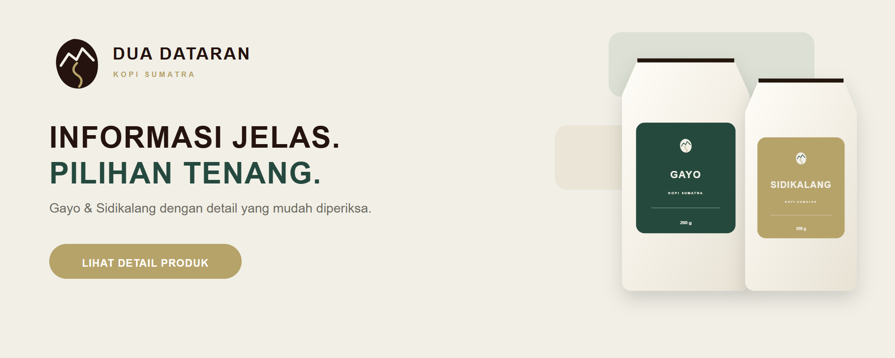

*Existing design output. Brand registration, actual product composition, packaging permissions, price, stock, and product claims require validation before commercial use. No sales or customer results are asserted.*

### Gargantula Boss: Adventure: Boss Level

**Academic VFX compositing contribution · Completed local scene render**

My academic work covers live-action and CGI integration for the Gargantula Boss scene: rotoscoping, tracking, layered effects, and color grading in Adobe After Effects. This is a specific compositing contribution, not authorship of every creature, stock effect, or the entire film.

**Text only by my publication choice.** A final scene render was inspected locally, but its frames stay private pending production/asset display permission. Thesis documents, academic identifiers, signatures, and source media are not published.

## Additional work and publication limits

The inventory covers the accessible local project collections and the seven repositories visible in my GitHub account during review. It is not a claim to have searched every disk, cloud account, or historical backup. The following work was considered rather than silently omitted:

| Project or group | Evidence and publication decision |
| --- | --- |
| Personal engineering/VFX portfolio | Existing Next.js site and local preview. Kept text-only because other sections contain unverified numerical claims and the captured header includes personal contact/photo material. |
| Personal web playground | Separate private Next.js repository. Personal content is intentionally not reproduced. |
| Marketing-image generator | Experimental image-generation tooling with existing outputs. No generated person is promoted as a real customer; execution requires security review. |
| Alpha Brotherhood / Radja Mahabbah | Fragrance-page design concept. Full-page visual withheld because brand rights and efficacy/testimonial claims are not established. |
| FlowJob extensions, bots, curriculum pages, and design iterations | Related product components, not additional launches. Operational account/session material and private educational content remain excluded. |
| Legacy market screenshot/Discord automation | Private utility experiments, not a public data product. Account secrets and third-party chart content are excluded. |
| Shopee crawler experiments | Related to product-research tooling; no crawler was executed and no customer/store dataset is published. |
| Empty airport-app folder | No application evidence found; not listed as a completed project. |
| Deployment branches, recovery folders, and backups | Duplicates/worktrees rather than independent projects. |
| What If animation toolkit, Flow Kit, Wassapkita, ScoffieldProject, and downloaded reference assets | Upstream tools or reference material, not claimed as independently authored products. |
| Device setup, private document automation, and personal-data folders | Not public product evidence; device/account details and private documents remain outside the portfolio. |

### Publication boundary

Only selected images and this editorial description are published. Application source, internal architecture documents, credentials, backend configuration, customer records, browser-session data, licensed datasets, and private media stay outside this repository. Crops omit sensitive or uncleared content; they do not alter the application to invent functionality. Where visual evidence is unavailable, the limitation is explicit.
