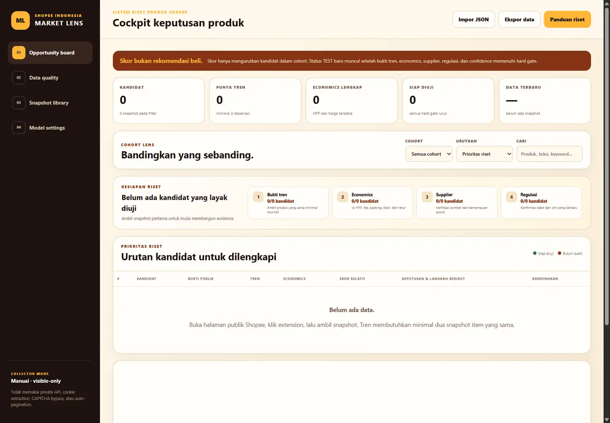
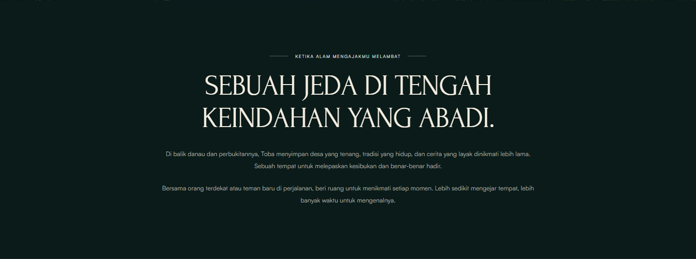
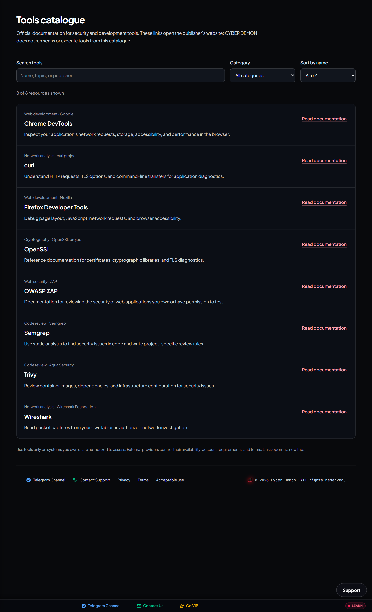
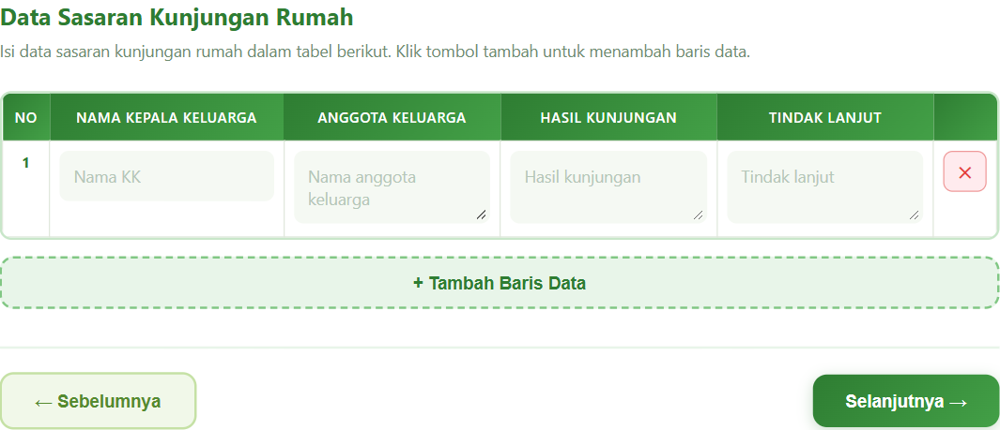
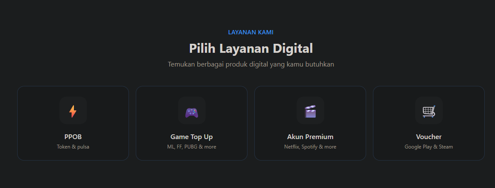
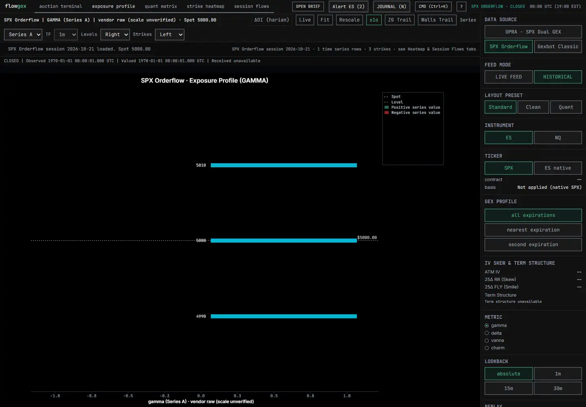
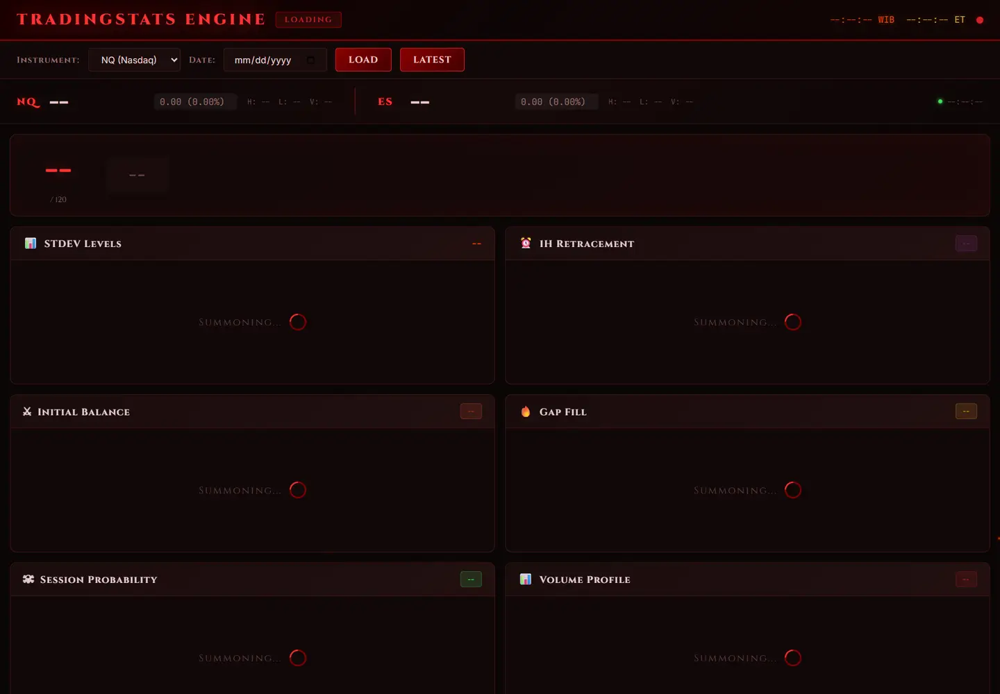
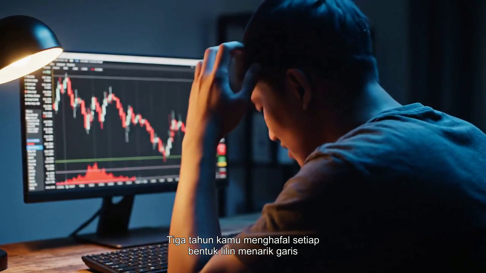
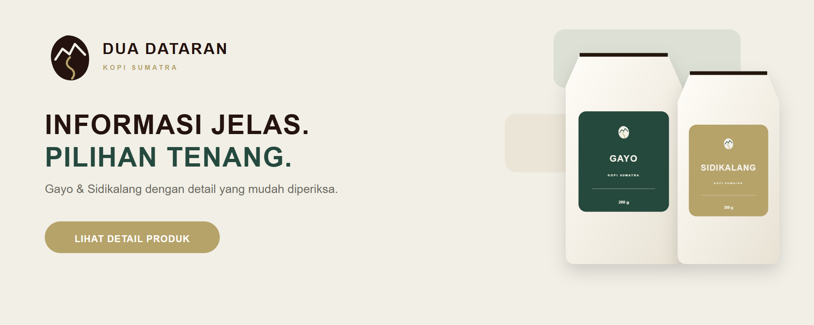

# Hi There! 👨‍💻

I'm **Iqbal**. I hold a bachelor's degree in Information Technology and build products at the intersection of finance and technology.

I work in consulting across finance and tech, and I founded and built **FlowJob** and **FlowStore** as a solo developer. My work connects the public website with what happens next: accounts, payments, customer workspaces, and the tools needed to operate them.

I'm interested in making useful products that people return to, not just projects that look good in a demo.

**React · Next.js · TypeScript · PostgreSQL**  
Based in Medan, Indonesia. Open to frontend and full-stack opportunities, onsite in Medan or remote.

## Selected work

### FlowJob
**Futures education & Trading Journal · Founder & Solo Developer**

A learning platform paired with a journal for planning trades, recording decisions, and reviewing what happened. The journal is a recordkeeping tool, not a brokerage account or a trading-signal service.

[Read the case study](https://github.com/iqbalnett/flowjob-showcase) · [Visit FlowJob](https://www.flowjob.id/)

- **Built:** the public website, learning workspace, account-based journal, analytics, authentication, payment workflows, and operational dashboards.
- **Engineering focus:** keep identity separate from access rights; confirm payments on the server before granting access; organize journal records around accounts, models, and daily reviews.
- **Stack:** Next.js, React, TypeScript, Tailwind CSS, Supabase/PostgreSQL. The project uses Vitest and Playwright for testing.

### FlowStore
**Digital-service catalog & membership workspace · Founder & Solo Developer**

A product journey from browsing a catalog and comparing memberships to checkout and a returning customer's dashboard.

[Read the case study](https://github.com/iqbalnett/flowstore-showcase) · [Visit FlowStore](https://flowstore.digital/)

- **Built:** catalog search and categories, membership comparison, account flows, checkout, customer dashboards, and operational tools.
- **Engineering focus:** preserve package choices through registration; distinguish loading, empty, and failed states; keep search and filters usable during dashboard refreshes.
- **Stack:** Next.js, React, TypeScript, Tailwind CSS, Supabase/PostgreSQL, and QRIS payment integration. Service access uses FlowStore Bridge on supported desktop browsers.

Both previews are public-page screenshots captured on November 7, 2026, not customer workspaces. The linked repositories are case studies, not application source releases. Product availability and offers may change.

### FlowStream
**Sports-schedule browsing · Founder**

Search matches, filter by sport and time, and switch between Indonesian and English. Schedules and embedded streams use third-party providers; provider content and availability are outside the app's control.

[Visit FlowStream](https://flowstreamid.vercel.app/)

Public schedule captured on November 17, 2026. Third-party listings are shown as received, not independently verified fixtures or broadcast-rights claims.

## Web experiences & browser tools

Working interfaces and local prototypes, shown here rather than hidden behind a gallery link. [Capture notes and complete project inventory](https://github.com/iqbalnett/iqbalnett/blob/main/PROJECTS.md).

### Brew Theory
**Interactive coffee calculator · React, TypeScript, Vite**

Adjust dose and brew ratio to calculate espresso yield and Americano water. In the local preview, changing the dose updated the calculated amounts immediately.

*Local application capture. No commercial cafe deployment is claimed.*

### Shopee Market Lens
**Manual product-research extension · JavaScript, Chrome Manifest V3**

Capture public listings on demand, compare cohorts, inspect missing evidence, and configure research thresholds. The interface separates a research score from a purchase recommendation.

*Actual extension running with empty storage. No private seller research or invented rankings.*

### Toba Journeys
**Bilingual travel-planning frontend · HTML, CSS, JavaScript, Vite**

Destination discovery, itinerary exploration, and inquiry flows for North Sumatra. The editorial section below shows the site's typography and travel narrative.

*Local prototype, not a booking engine. Photographs are excluded until attribution is resolved.*

### CYBER DEMON
**Educational resource catalogue · React, TypeScript, React Router, Tailwind CSS**

A searchable collection of security and development resources. This sample shows the official-tools catalogue, not a scan result or access to private accounts.

*Local frontend capture. The broader UI adapts a public design reference; configured backend operations are not demonstrated.*

### Community-health visit form
**Multi-step form workflow · HTML, CSS, JavaScript**

Dynamic household rows, local drafts, print preparation, and photo previews. The empty second step below was reached through the actual form navigation.

*Anonymized sample published with permission. No institution branding, household records, signatures, or deployment claim.*

### TokoDigital
**Archived storefront prototype · Next.js, React**

Category discovery and product pages for digital goods, with WhatsApp-order entry points. This section comes from the existing local build.

*Prototype only; contact configuration, fulfillment, and commercial offers are not verified.*

## Analytics & research

### FlowGex
**Options analytics, replay & visualization · Python, browser UI**

Explore exposure profiles and historical state in a browser workspace. The existing deterministic fixture provides a way to inspect the interface without publishing licensed market recordings.

**Synthetic-data demonstration.** Values and connection indicators belong to the fixture, not a live feed or verified trading result.

### TradingStats Independent Trading Engine
**Futures-indicator research · Python, FastAPI, browser dashboard**

Research around retracements, standard-deviation levels, initial balance, gap behavior, session probabilities, and volume profiles.

*Disconnected local presentation. No market records or analytical-accuracy claims are included.*

**Other private research:** FlowGreeks covers options ingestion and replay in Python and Go; Flow Macro explores macro context; Zora Conviction Engine supports content planning and review. Their current captures are blocked, unconfigured, or not cleared for publication. [See each project's status](https://github.com/iqbalnett/iqbalnett/blob/main/PROJECTS.md#flowgreeks).

## Animation, video & design

### Dilema Dika
**Indonesian 2D animation · React, TypeScript, Remotion**

Character design, room blocking, storyboards, and motion studies for a slice-of-life series. This is a frame from the custom *Kirim Uang* storyboard.

*Preproduction, not a released episode. The production setup adapts the [FreshStack What If toolkit](https://github.com/kelano86/what-if-animation); inherited example episodes are not claimed as original work.*

### FlowRouter
**Batch-video workstation · Node.js, browser JavaScript**

Local tooling for generation queues, job routing, status, and saved-output review. Below is an actual retained output rather than an account-connected dashboard.

*Generated output still. Account identities, session data, and signed download URLs remain private.*

### Educational video pipeline
**Explainer production · Python, FFmpeg; related Remotion & Manim studies**

Assemble generated scenes, narration, subtitles, and explanatory graphics into chapter-based learning videos. This sample comes from an existing earlier assembly.

*Generated illustration, not a real customer or live chart. No audio or later internally restricted chapters are distributed.*

### Dua Dataran
**Coffee-brand design concept · Storefront banners & listing graphics**

A visual exploration for Gayo and Sidikalang coffee, including category graphics and product-listing layouts.

*Existing design asset, not a live-shop screenshot. Product details and commercial claims require validation.*

**Academic VFX:** my *Gargantula Boss* contribution to *Adventure: Boss Level* covers compositing, rotoscoping, tracking, effects layering, and color grading in After Effects. Frames remain private pending production/asset display permission.

## Engineering decisions behind the visuals

- **FlowJob:** separate identity from access rights and confirm payment before granting access.
- **FlowStore:** preserve package choices across account flows and distinguish loading, empty, and failed states.
- **Brew Theory:** make recipe calculations respond to input rather than present a static illustration.
- **Market Lens:** show evidence quality separately from a research score.
- **FlowGex:** demonstrate the interface with explicitly labeled synthetic inputs instead of exposing licensed records.

This is independent project work alongside consulting, not a list of employment positions. [The complete inventory](https://github.com/iqbalnett/iqbalnett/blob/main/PROJECTS.md#additional-work-and-publication-limits) also records personal web experiments, marketing-image tooling, and withheld concepts. Duplicate worktrees and upstream tools are not counted as original products.

**Publication boundary:** application source, credentials, customer records, browser sessions, and licensed datasets remain private. All previews above are actual captures or existing outputs; none is a fabricated product screenshot.

## Technologies I use

**Frontend:** React, Next.js, TypeScript, JavaScript, Tailwind CSS, HTML, CSS  
**Backend & data:** Node.js, PostgreSQL, Supabase, Python  
**Development & media:** Git, Remotion, FFmpeg

## Education & connection

Bachelor's degree in **Information Technology**.

[Instagram](https://www.instagram.com/ib.872haueterg/) · [FlowJob case study](https://github.com/iqbalnett/flowjob-showcase) · [FlowStore case study](https://github.com/iqbalnett/flowstore-showcase)
