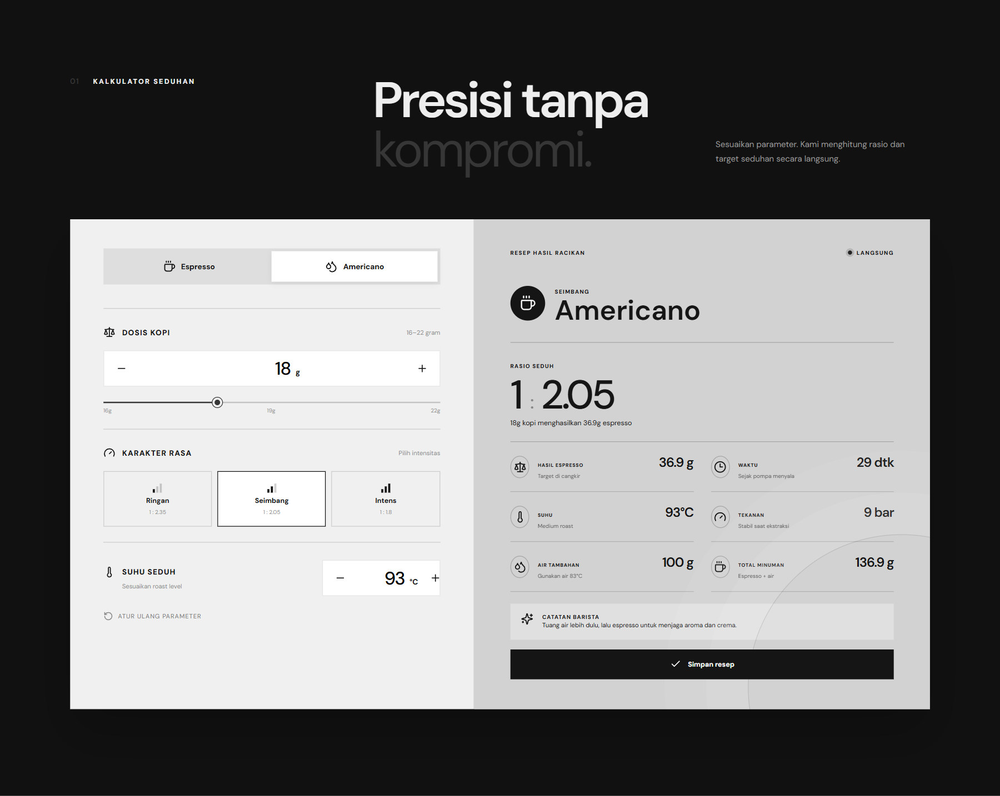

# Hi There! 👨‍💻

I'm **Iqbal**. I hold a bachelor's degree in Information Technology and build products at the intersection of finance and technology.

I work in consulting across finance and tech, and I founded and built **FlowJob** and **FlowStore** as a solo developer. My work connects the public website with what happens next: accounts, payments, customer workspaces, and the tools needed to operate them.

I'm interested in making useful products that people return to, not just projects that look good in a demo.

**React · Next.js · TypeScript · PostgreSQL**  
Based in Medan, Indonesia. Open to frontend and full-stack opportunities, onsite in Medan or remote.

## Selected work

### FlowJob
**Futures education & Trading Journal · Founder & Solo Developer**

A learning platform paired with a journal for planning trades, recording decisions, and reviewing what happened. The journal is a recordkeeping tool, not a brokerage account or a trading-signal service.

[Read the case study](https://github.com/iqbalnett/flowjob-showcase) · [Visit FlowJob](https://www.flowjob.id/)

- **Built:** the public website, learning workspace, account-based journal, analytics, authentication, payment workflows, and operational dashboards.
- **Engineering focus:** keep identity separate from access rights; confirm payments on the server before granting access; organize journal records around accounts, models, and daily reviews.
- **Stack:** Next.js, React, TypeScript, Tailwind CSS, Supabase/PostgreSQL. The project uses Vitest and Playwright for testing.

### FlowStore
**Digital-service catalog & membership workspace · Founder & Solo Developer**

A product journey from browsing a catalog and comparing memberships to checkout and a returning customer's dashboard.

[Read the case study](https://github.com/iqbalnett/flowstore-showcase) · [Visit FlowStore](https://flowstore.digital/)

- **Built:** catalog search and categories, membership comparison, account flows, checkout, customer dashboards, and operational tools.
- **Engineering focus:** preserve package choices through registration; distinguish loading, empty, and failed states; keep search and filters usable during dashboard refreshes.
- **Stack:** Next.js, React, TypeScript, Tailwind CSS, Supabase/PostgreSQL, and QRIS payment integration. Service access uses FlowStore Bridge on supported desktop browsers.

Both previews are public-page screenshots captured on November 7, 2026, not customer workspaces. The linked repositories are case studies, not application source releases. Product availability and offers may change.

### FlowStream
**Sports-schedule browsing · Founder**

Search matches, filter by sport and time, and switch between Indonesian and English. Schedules and embedded streams use third-party providers; provider content and availability are outside the app's control.

[Visit FlowStream](https://flowstreamid.vercel.app/)

Public schedule captured on November 17, 2026. Third-party listings are shown as received, not independently verified fixtures or broadcast-rights claims.

### More than the live websites

**[Browse the complete project gallery](PROJECTS.md)** for web prototypes, analytics research, browser tools, animation, and design work. Each entry distinguishes a public site, local preview, synthetic-data demonstration, or existing production output.

## How I approach the work

- **Build beyond the landing page.** Connect interfaces to accounts, data, permissions, and the workflows people return to.
- **Make state visible.** Treat pending payments, background refreshes, empty results, and failures as distinct parts of the experience.
- **Explain the decisions.** Use case studies, user guides, and system diagrams to show how a product works and where its boundaries are.

My experience here is independent project work, alongside consulting, rather than a list of positions held at other companies.

## Engineering & creative projects

The **[project gallery and status register](PROJECTS.md)** includes:

- **Web & browser tools:** Toba Journeys, Brew Theory, Shopee Market Lens, CYBER DEMON, a community-health visit form, and the TokoDigital storefront prototype.
- **Analytics & research:** FlowGex, FlowGreeks, TradingStats Independent Trading Engine, Flow Macro, and Zora Conviction Engine.
- **Media & design:** FlowRouter, Dilema Dika, the educational video pipeline, Dua Dataran, and my academic compositing contribution to *Adventure: Boss Level*.
- **Additional experiments:** personal portfolio sites, marketing-image tooling, and a fragrance-page concept. Their publication limits are recorded rather than hidden.

Local prototypes are not presented as public launches. Blank, blocked, or unconfigured screens are not used to imply a working product. Third-party toolkits and duplicate worktrees are not counted as original products.

Application source, credentials, customer records, browser-session data, and licensed datasets remain private.

## Technologies I use

**Frontend:** React, Next.js, TypeScript, JavaScript, Tailwind CSS, HTML, CSS  
**Backend & data:** Node.js, PostgreSQL, Supabase, Python  
**Development & media:** Git, Remotion, FFmpeg

## Education & connection

Bachelor's degree in **Information Technology**.

[Instagram](https://www.instagram.com/ib.872haueterg/) · [FlowJob case study](https://github.com/iqbalnett/flowjob-showcase) · [FlowStore case study](https://github.com/iqbalnett/flowstore-showcase)
