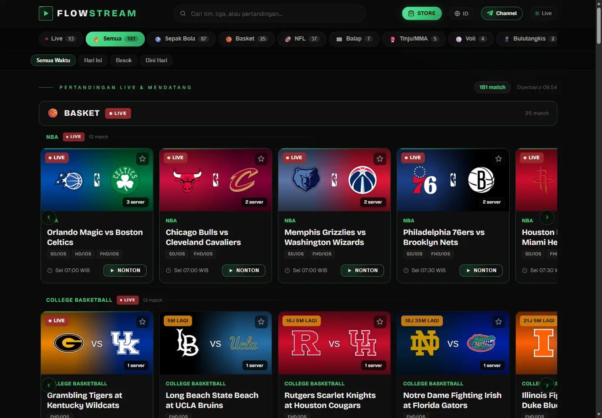

# Hi There! 👨‍💻 I'm Iqbal.

### Full-stack development, with the whole product in mind.

I build web products from the first screen to the workflows people come back for: accounts, payments, personal workspaces, and the tools that keep them running.

I'm the founder and solo developer of **FlowJob** and **FlowStore**, and I also built **FlowStream**. Alongside consulting across finance and technology, these projects are where I put product thinking and engineering into practice. I care about the details between features, not only how they look in isolation.

**React · Next.js · TypeScript · PostgreSQL**  
Medan, Indonesia · Bachelor's degree in Information Technology  
Open to frontend and full-stack opportunities in Medan or remotely.

[FlowJob](https://www.flowjob.id/) · [FlowStore.digital](https://flowstore.digital/) · [FlowStream](https://flowstreamid.vercel.app/) · [Instagram](https://www.instagram.com/ib.872haueterg/)

## Three products, three different problems

### FlowJob
**Futures education & Trading Journal · Founder & Solo Developer**

Learning about markets and reviewing your own decisions are often separate activities. I built FlowJob to connect a structured learning path with a journal for plans, trades, and daily reflection.

**My scope**

- **Product and frontend:** the public website, curriculum navigation, learning workspace, and user documentation.
- **Application workflows:** account-based journals, setup models, trade records, daily reviews, and analytics.
- **Full-stack delivery:** authentication, payment-to-access workflows, and member and administrative interfaces.

**A decision that matters:** signing in is not the same as having paid access. I separated identity from access rights and made server-confirmed payment the basis for granting access. In the journal, records connect to accounts and setup models so a review can examine the decision, not just the result.

*Public journal guide, not a customer's trading history. FlowJob is an education and recordkeeping product, not a brokerage or signal service.*

**Built with:** Next.js, React, TypeScript, Tailwind CSS, Supabase/PostgreSQL. Testing tools include Vitest and Playwright.

[Read the FlowJob case study](https://github.com/iqbalnett/flowjob-showcase) · [Visit the website](https://www.flowjob.id/) · [Read the journal guide](https://www.flowjob.id/docs/welcome?lang=id)

---

### FlowStore.digital
**Digital-service catalog & membership workspace · Founder & Solo Developer**

A large catalog is useful only if people can understand their choices and find their way back after buying. I built FlowStore around that journey: discover a service, compare memberships, complete checkout, and return to a personal workspace.

**My scope**

- **Discovery and selection:** searchable categories, package comparison, duration choices, and responsive catalog layouts.
- **Purchase and return visits:** registration, sign-in, QRIS checkout, order status, and membership-aware dashboards.
- **Product operations:** interfaces for orders, customers, catalog management, and the supported desktop-browser Bridge experience.

**A decision that matters:** a refresh should not erase the user's context. I distinguished first load from background refresh, kept search and filters available, and treated a failed refresh differently from a successful empty result. Package and duration choices also carry through the account flow.

*Public catalog, not an authenticated customer dashboard. Service availability and offers can change; Bridge use requires a supported desktop browser.*

**Built with:** Next.js, React, TypeScript, Tailwind CSS, Supabase/PostgreSQL, and QRIS payment integration.

[Read the FlowStore case study](https://github.com/iqbalnett/flowstore-showcase) · [Visit FlowStore.digital](https://flowstore.digital/)

---

### FlowStream
**Sports-schedule discovery · Independent Web Project**

Finding a match should not mean searching through an undifferentiated list. I built a compact browsing interface around sport, time, and search, with Indonesian and English language options.

**My scope**

- **Frontend:** responsive schedule layouts, grouped match cards, sport tabs, time filters, and search.
- **Interface states:** live/upcoming labels, no-results feedback, and language switching.
- **Integration:** browser-side schedule retrieval and third-party embed entry points.

**A decision that matters:** this product does not need the same framework footprint as an account-based application. I used HTML, CSS, and JavaScript for the browsing surface, while keeping provider availability separate from what the interface can promise.

*The preview shows schedule discovery, not video playback. Listings and embedded content come from third parties; their accuracy, availability, and broadcast permissions are outside the scope of this portfolio.*

**Built with:** HTML, CSS, JavaScript, and browser APIs. Search no-results feedback and Indonesian/English switching were checked on the public site during this profile review.

[Visit FlowStream](https://flowstreamid.vercel.app/)

## What I bring to a team

**Ownership across the product.** I am comfortable moving between interface work, data-backed workflows, integration boundaries, documentation, and operational needs. Building my own products has made me pay attention to what happens after a feature ships.

**Care with state and failure.** A selected package, pending payment, stale list, and empty search are different situations. I try to make those differences understandable instead of leaving users to guess.

**Practical technical choices.** I use React and Next.js for account-based applications, PostgreSQL for structured data, and a lighter frontend when that fits the problem. I prefer explaining a trade-off to claiming that one stack solves everything.

These are independently built projects, not claims of employment at other companies. I am still learning, and I value clear feedback, thoughtful review, and working with people who care about the product.

## Let's work together

I'm interested in frontend and full-stack work where I can contribute to both the interface and the workflows behind it.

**Medan or remote.** [Connect on Instagram](https://www.instagram.com/ib.872haueterg/) or explore the case studies above for a closer look at my work.

Portfolio boundary: case studies and public-page images only. Application source, credentials, customer records, browser sessions, and licensed data remain private. FlowJob and FlowStore images were captured November 7, 2026; FlowStream on November 17, 2026. Screenshots document the interface at capture time, not product scale, financial results, or a guarantee of current availability.
