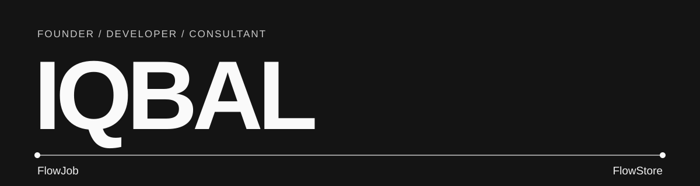

## Hi There! 👨‍💻

I'm **Iqbal**. I hold a bachelor's degree in Information Technology and build products at the intersection of finance and technology.

- I currently work in consulting across finance and tech.
- I founded and built FlowJob and FlowStore as a solo developer.
- I'm interested in making useful products that people return to, not just projects that look good in a demo.

## 📚 Projects

| Project | Live product | What it does |
| --- | --- | --- |
| [FlowJob](https://github.com/iqbalnett/flowjob-showcase) | [Website](https://www.flowjob.id/) | Futures education and a Trading Journal for planning and reviewing decisions. |
| [FlowStore](https://github.com/iqbalnett/flowstore-showcase) | [Website](https://flowstore.digital/) | Digital-service catalog, membership comparison, checkout, and a customer dashboard. |

These repositories are **product case studies**, not application source code. They document public-facing features and system responsibilities without publishing credentials, customer data, or private implementation details.

## 👔 Experience

| Role | Focus |
| --- | --- |
| Consultant | Finance and technology. |
| Founder & Solo Developer | Product design, full-stack development, and operations for FlowJob and FlowStore. |

## 🎓 Education

- Bachelor's degree in Information Technology.

## 🛠 Technologies I Use

- **Frontend:** React, Next.js, TypeScript, Tailwind CSS
- **Backend & data:** Node.js, PostgreSQL, Supabase
- **Product workflows:** Authentication, payment integrations, member access, and operational tools

## Socials

[GitHub](https://github.com/iqbalnett) · [FlowJob](https://www.flowjob.id/) · [FlowStore](https://flowstore.digital/)
